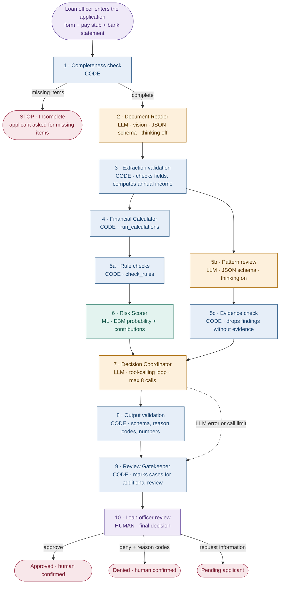
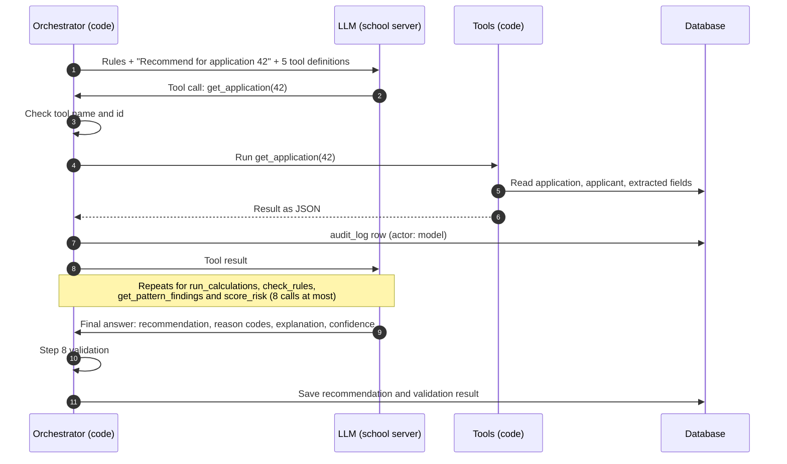

# Phase 2: Improvements, model graphs, the LLM layer, and the dashboard

This file continues the project built from `CLAUDE.md`. **Every rule in `CLAUDE.md` still
applies**, with these exceptions:
- The LLM parts that `CLAUDE.md` called "out of scope" are now in scope (Part E).
- The user approves one new rule, `INCOME_MISSING` (Part A).
- Rule 9 of `CLAUDE.md` (stop after each step) is replaced by the working mode below.

Read `CLAUDE.md`, `README.md`, and this file fully before starting.

## Working mode: run to the end, log everything

Work through Parts A to G in order **without waiting for the user between steps**. Run each
step's test. If it fails, try to fix it (at most 3 attempts), then record the outcome and move on.

### Build log
Create `BUILD_LOG.md` first. Move the build recap currently in `README.md` into it as
"Phase 1" (README becomes the GitHub documentation in Part G). Then, after **every** step,
append an entry:

```
### A1. INCOME_MISSING rule — ✅ Done
- Test: <what was run and the result>
- Changes: <files changed>
- Decisions: <choices the spec left open, and why>
- Problems: <what went wrong and how it was fixed, or "none">
```

Status is one of: ✅ Done · ⚠️ Done with issues (explain) · ❌ Failed (explain what was tried) ·
⏭️ Skipped (explain why). Never mark a step ✅ if its test didn't pass. At the end, add a summary
table of all steps with their status, and a list of everything waiting for the user.

### Git checkpoints
Before the first commit, run `git status` and confirm that `loans.db`, `.env`, `models/`,
`uploads/`, `samples/`, and `models_experiments/` are not listed. Then commit at the end of each
part (A to G) with a message like `Phase 2 Part A: review fixes`. Never commit secrets or data.
If something breaks later, the last good part can be restored.

### Stop and ask the user only when
1. Credentials or the school server are missing or don't work (E0).
2. A failed step blocks every remaining step after 3 fix attempts.
3. A change would delete or modify rows in a non-empty table of the real `loans.db`.
4. A change would alter `RULES` thresholds, the protected-feature rules, or any rule in
   `CLAUDE.md` or this file.
5. Something requires installing software outside `pip` (a system program or service).

When blocked, record it in `BUILD_LOG.md`, **continue with every remaining step that doesn't
depend on the blocked one**, and only then stop and report. For example, if the server
connection fails at E0, skip Part E and the chatbot in Part F, finish everything else, then ask.

Decisions that used to be STOPs (B1 and E10) now follow written decision rules. Record the
decision and the numbers behind it in `BUILD_LOG.md`, so the user can change it afterward.

---

## Rules added in this phase

10. **The LLM never produces a number.** Income, ratios, payments, and the risk score come only
    from extraction (read from a document), `run_calculations()`, `check_rules()`, or
    `RiskScorer.score()`. Code checks every number in the LLM's output against those sources.
11. **The LLM never makes the final decision.** It writes a recommendation. Every application
    still goes to the loan officer.
12. **Every LLM call is bounded and logged.** Maximum tool calls per application, a timeout, and
    an `audit_log` row with actor `model` for each call (model name, purpose, duration, tool
    calls). Never log the API key or full document images.
13. **Secrets live only in `.env`.** Never print `LLM_API_KEY`, never write it to a file other
    than `.env`, and never include it in error messages.
14. **Experiments never touch `models/`.** The dashboard loads the newest model in `models/`, so
    experiment models go to `models_experiments/` (git-ignored).
15. **Applicant documents are sent only to the school server in `LLM_BASE_URL`.** No other
    external service.

---

## Part A. Fixes from the README review

### A1. `INCOME_MISSING` rule (approved by the user)
In `calculations.py`, add a flag `INCOME_MISSING`, severity **critical**, when income is zero,
negative, or missing. It fires before the ratio rules (which are skipped because the ratios are
`None`). Evidence: `{"value": <income>, "limit": "> 0"}`.
**Test:** income 0 gives only `INCOME_MISSING` (plus any credit or prior-default flags); the
existing tests 1 and 2 still pass.

### A2. Audit log protected in the database
Keep the ORM guard, and add two SQLite triggers on `audit_log` that raise an error on
`UPDATE` and `DELETE`. Create them in `get_engine()` with `CREATE TRIGGER IF NOT EXISTS`.
**Test:** a raw-SQL `UPDATE` and a raw-SQL `DELETE` on `audit_log` both fail. Run the test on a
copy of the database, as before.

### A3. Fairness compared to the largest group
In the fairness report, divide each group's favorable rate by the **largest** group's rate in
that category, not the best group's. Show each group's size, and mark groups under 100 people as
"small sample". Keep the 0.8 warning line.
**Test:** print the new tables for gender and age band.

### A4. No more "1.0" probabilities on screen
Everywhere a probability is shown, values above 0.99 display as "above 99%" and values below
0.01 as "below 1%". Stored values are unchanged.

---

## Part B. Model experiment

### B1. Train four variants into `models_experiments/`
Add `--out models_experiments` support where needed, plus options to set interactions and drop
features, without changing the defaults. Train on the same split (`random_state=42`):

| Variant | Change from the current model |
|---|---|
| a | None (current settings) |
| b | `interactions=0` (one term per feature) |
| c | b, without `person_emp_exp` and `cb_person_cred_hist_length` (age proxies) |
| d | c, without `loan_int_rate` (set by the lender after judging risk) |

Show one comparison table: AUC, Brier, number of terms, and the fairness ratios (A3 version) for
gender and each age band.

**Decision rule (instead of stopping):** choose the **simplest** variant (latest letter: d is
simplest, a is the most complex) that meets both conditions:
- AUC at most 0.01 below the best variant's AUC
- No fairness ratio below 0.8 for any group with 100 people or more

If no variant meets both, choose the one with the highest lowest fairness ratio. Put the full
table and the reasoning in `BUILD_LOG.md`.

### B2. Train the chosen variant as the main model
Train it into `models/` with the normal command and options. Update `train_ebm.FEATURES` if the
chosen variant drops features, and update the dashboard form so it only asks for the features
the model uses. `loan_int_rate` stays on the form even if dropped from the model, because the
monthly payment calculation needs it.
**Test:** the scorer loads the new model (its feature-list check passes) and scores the step 3
test applicant.

---

## Part C. Model performance and EBM graphs

`train_ebm.py` saves everything the graphs need into the model's `.json`, so the Model page
never reloads the data or retrains. Keep each list short (downsample curves to about 100 points).

### C1. Save performance data at training time (test set)
- ROC curve points and AUC
- Calibration: for 10 bins of predicted probability, the average predicted value and the actual
  default rate, plus the count in each bin
- Score distribution: histogram of predicted probability, split by actual outcome
- Confusion matrix at 0.5: counts and rates

### C2. Save EBM explanation data at training time
Use `ebm.explain_global().data(i)` (works in `interpret-core`; do not call `.visualize()`), or
`ebm.term_scores_` with `ebm.bins_` if needed. For each term save:
- **Single features:** the bin edges or category names, the contribution (log-odds) per bin,
  the upper and lower bounds, and the data density per bin
- **Pairs (only if the chosen model has interactions):** the 2D grid of contributions
- Global importance per term (already saved)

### C3. Model page (page 2) layout
Keep the existing content and add sections in this order:

1. **Performance:** ROC curve with the diagonal reference line and AUC in the title; confusion
   matrix at 0.5.
2. **Calibration:** predicted vs actual default rate per bin, with the perfect-calibration
   diagonal, plus the table with counts. This is the check for over-confident scores.
3. **Score distribution:** predicted probability histogram, one color per actual outcome.
4. **How the model sees each feature (shape functions):** a feature selector, then a line chart
   (numbers) or bar chart (categories) of contribution vs feature value, with the bounds as a
   shaded band and a small density histogram underneath. Positive values raise risk. Add one
   sentence explaining how to read it.
5. **Interactions:** a heatmap per pair term, only if the model has pairs.
6. Global importance and fairness (existing, fairness updated per A3).

### C4. Applicant explanation (pages 3 and 4)
Replace or complement the contribution bar chart with a **waterfall**: start at the baseline
log-odds, add each term's contribution (largest first, then "N other terms combined"), and end
at the applicant's score, with the final probability labeled. It must add up exactly, as the
README already verifies.

Use the same colorblind-checked colors as the existing charts. **Test:** pages render without
errors, and the waterfall total equals the stored score for one test applicant.

---

## Part D. Returning applicants

The scoring form currently creates a new `applicants` row every time, even for someone who
applied before. Add a choice at the top of page 3: **New applicant** or **Existing applicant**
(search by name, show id and created date). An existing applicant gets a new `applications`
row linked to the same `applicant_id`. Page 4 shows the applicant's earlier applications and
their outcomes. No schema change is needed.
**Test:** two applications for one applicant share an `applicant_id`.

---

## Part E. The LLM layer

### E0. Connection settings and test
Add to `.env` (the user fills in values) and create `.env.example` with the names only:

```
LLM_BASE_URL=     # school server address, e.g. https://server:11434
LLM_API_KEY=      # school server key
LLM_MODEL=qwen3.5:latest        # development model
LLM_MODEL_FINAL=qwen3.5:35b     # final model
LLM_NUM_CTX=32768
LLM_TIMEOUT_SECONDS=120
```

The server lists models in Ollama format, so start with Ollama's native API (`/api/tags`,
`/api/chat`) and send the key as `Authorization: Bearer <key>`.
**Test:** list the server's models and send one short message to `LLM_MODEL`.
If the connection fails or the server uses a different API or key format, this is a blocking
problem (stop condition 1): record the error in `BUILD_LOG.md` without the key, skip Part E and
the chatbot (F3), finish the other parts, then ask the user. Do not guess at another format.

### E1. `llm.py`: one small client
A single module used by every LLM step. Functions take: messages, optional images, optional JSON
schema, optional tools, and a `think` switch. Always set `num_ctx` from `.env` (the server's
default context is much smaller than the model's maximum) and `temperature` 0. One retry on a
timeout or connection error, then raise a clear error. Each call writes an `audit_log` row
(rule 12). Add `requests` (or `httpx`) and `pypdfium2` to `requirements.txt`.

### E2. Document storage
Files are stored on disk in `uploads/<application_id>/` (git-ignored). The database stores the
path, not the file. Recreate the empty `documents` and `extracted_fields` tables with these
added columns, **after confirming both have 0 rows** (never touch other tables):
- `documents`: `original_filename`, `mime_type`, `size_bytes`, `sha256`, `page_count`
- `extracted_fields`: `extraction_model`, `needs_review` (bool)

The SHA-256 hash proves later that a document wasn't changed after review.
Accepted files: PDF, PNG, JPG, up to 10 MB each. PDFs are rendered to page images with
`pypdfium2` before being sent to the model.

### E3. Sample documents for testing
Create `make_samples.py`: for 20 applicants from `historical_loans`, generate a pay stub and a
bank statement as PDFs with fictional employer and bank names, and **"SAMPLE - NOT A REAL
DOCUMENT"** printed on every page. Income on the documents matches the row's income, except for
5 applicants where the pay stub income is 20% to 40% higher than stated (planted mismatches).
Save an answer key (`samples/answer_key.json`) with the correct values and which ones are
planted. `samples/` is git-ignored. Add `fpdf2` to `requirements.txt`.

### E4. Document Reader (workflow steps 2 and 3)
- Model call with the page images, **thinking off**, and a JSON schema per document type:
  - Pay stub: employer, pay period (weekly, biweekly, semimonthly, monthly), gross pay for the
    period, pay date, page number of each value
  - Bank statement: bank name, statement period, opening and closing balance, total deposits,
    page number of each value
- Prompt: extract only what is printed; use `null` for anything not found; never calculate.
- **Code then validates (step 3):** the JSON matches the schema; values have the right types;
  annual income computed by code from gross pay and pay period; dates are plausible. Any failure
  or `null` required field sets `needs_review=True`, and the application is marked for
  additional review. The model's self-reported confidence is not trusted on its own.
- The computed annual income becomes `documented_income` for `check_rules()`, so
  `INCOME_MISMATCH` now uses real documents.

**Test:** on the 20 samples, report field accuracy against the answer key and the share of
valid JSON responses.

### E5. Pattern review (workflow step 5b)
One model call with **thinking on**, given the extracted fields from all of the applicant's
documents and the form data (no images). It returns a list of findings, each with a `code`, a
`description`, and `evidence` that points to a document and field. Examples: pay dates that don't
match the pay period, deposits inconsistent with stated income, employer names that differ
between documents.
**Code then checks every finding:** the cited document and field must exist. Findings without
valid evidence are discarded and logged. Valid findings are saved to `flags` with
`source="pattern"` and severity `warning`. The model cannot create critical flags.

### E6. Decision Coordinator (workflow step 7)
A tool-calling loop with **thinking on**. It runs after code has finished steps 1 to 6 and saved
their results. The tools give the model those results:

| Tool | Returns | Wraps |
|---|---|---|
| `get_application` | Form data, loan request, the applicant's earlier applications, documents with extracted fields, page numbers, and `needs_review` markers | Database read |
| `run_calculations` | Loan-to-income, monthly payment, payment-to-income, with assumptions | `run_calculations()` |
| `check_rules` | Rule flags with value and limit | `check_rules()` with `documented_income` from extraction |
| `get_pattern_findings` | Verified pattern findings with evidence | Results of step 5b |
| `score_risk` | Default probability, baseline, contributions, top drivers and protective factors, model version | `RiskScorer.score()` |

Tool design:
- **Every tool takes only `application_id`.** The model can't pass its own numbers into a
  calculation, so every number it receives comes from code.
- **Tools read stored results.** If a result is missing, the tool computes it with the same
  function, saves it, and returns it. The model sees exactly what the database holds.
- **Tools never write decisions** and never change an application's status.
- The orchestrating code checks each tool call before running it: the name must be one of the
  five tools and `application_id` must be the current application. Anything else returns an
  error message to the model and counts toward the limit.

Limits: at most 8 tool calls, then stop and mark the application for additional review.
The final answer is JSON: `recommendation` (`approve`, `deny`, or `refer`), `reason_codes`, a
short `explanation` for the officer, and `confidence` (0 to 1).
The system prompt says: base every statement on tool results, never state a number that no tool
returned, never override the risk score, and explain using the score's top contributions and
the flags.

### E7. Output validation (workflow step 8)
Plain code. The recommendation fails validation if any of these is true:
- The JSON doesn't match the schema, or a reason code is not one of the flag codes, the
  `MODEL_DRIVER:<term>` codes, or the general reason list
- The explanation contains a number that doesn't match a tool result (allow normal rounding)
- `approve` while a critical flag exists or the default probability is 0.5 or above
- `deny` with no flags and a default probability below 0.2

Save `passed_validation`. A failure keeps the recommendation visible but marks the application
for additional review with the failure reasons in `review_reasons`.

### E8. Review Gatekeeper (workflow step 9)
Every application goes to the officer (rule 11). Mark it for additional review if any of: a
critical flag, a failed validation, `needs_review` on any extracted field, a confidence below
0.7, a tool-call limit reached, or an LLM error. List the reasons in `review_reasons`.

### E9. Dashboard integration
- Page 3: document upload (pay stub and bank statement), then the whole workflow runs with a
  progress display per step, in this order: completeness check, Document Reader, extraction
  validation, calculations, rule checks, pattern review, risk score, Decision Coordinator,
  output validation, gatekeeper. If the LLM is unavailable, the application is still saved with
  rule checks and score, marked `LLM_UNAVAILABLE` for additional review.
- Page 4: shows the documents (with a view link), extracted fields with their page numbers and
  `needs_review` markers, pattern findings with evidence, the Coordinator's explanation, the
  validation result, and the review reasons. The officer can confirm or correct an extracted
  field; that sets `verified_by_human=True` and writes an `audit_log` row.

### E10. Evaluation
Run the full workflow on the 20 samples with `LLM_MODEL`, then with `LLM_MODEL_FINAL`. One table
per model: extraction field accuracy, valid JSON rate, planted mismatches caught (out of 5),
false mismatch flags (out of 15), validation pass rate, average seconds per application.
Use a copy of the database for this run.

**Decision rule (instead of stopping):** use `LLM_MODEL` (the smaller model) if it is within
5 percentage points of `LLM_MODEL_FINAL` on extraction field accuracy, catches at least as many
planted mismatches, and has a validation pass rate within 5 points. Otherwise use
`LLM_MODEL_FINAL`. Set the dashboard's model with an `LLM_MODEL_ACTIVE` variable in `.env`
(add the name to `.env.example`). Put both tables and the reasoning in `BUILD_LOG.md`.

---

## Part F. Dashboard additions

Use the same colorblind-checked palette as the existing charts, and keep text labels on chart
marks so color is never the only cue.

### F1. Recommendations in the officer review queue (page 4)
The queue list itself (before selecting an application) shows one row per application with:
applicant name, loan amount, recommendation (approve, deny, or refer, as a colored label),
default probability (A4 format), number of critical flags, validation result, confidence,
"marked for additional review" with its reasons, and submitted date.
Marked cases come first, then oldest first. Add filters by recommendation and by marked status.
Applications created before Part E show "refer" and an empty confidence; display that cleanly.
**Test:** on a database copy with three scored applications, the list shows all three with
their recommendations, and the filters work.

### F2. Borrower insights (page 1, new tab)
Page 1 gets two tabs: **Overview** (the existing content) and **Borrower insights**.
All charts use the cleaned rows by default and follow the page's existing "include all rows"
toggle. The dataset has no dates, so line charts show **ordered groups**, not time.

| Chart | Type | Shows |
|---|---|---|
| Who borrows and who defaults | Nested donut (Plotly sunburst) | Inner ring: share of borrowers by loan intent. Outer ring: repaid vs defaulted within each intent. Labels show percentages. |
| Default rate across ordered groups | Line charts with markers | Default rate by credit score band, income band (deciles), loan-to-income band, age band, and years of employment. A selector picks the variable. Show the overall default rate as a dashed reference line and the group size on hover. |
| Default rate by category | Bar charts | Default rate by education, home ownership, loan intent, and gender, sorted by rate, with group sizes. |
| Loan size by purpose | Bar chart | Median loan amount and median loan-to-income by intent. |
| Rule limits in the data | Bar chart | Share of borrowers crossing each `RULES` limit, and their default rate vs everyone else. |

Above the gender and age charts, show this note: "Gender and age are shown to understand the
data and to check fairness. The risk model does not use them, and they must never be used to
decide an application." Show group sizes everywhere, and hide or grey out groups under 100
people with a "small sample" label.
**Test:** the tab renders with the cleaned rows and with all rows.

### F3. Assistant chat panel (all pages, right side)
Skip this step if Part E is blocked; it needs the LLM client.

**Layout:** every page puts its content in a left column and a chat panel in a narrower right
column (about one quarter of the width), through one helper in `app/shared.py`. On narrow
screens the panel moves below the content. Messages appear as chat bubbles with
`st.chat_message`: the user's on the right, the assistant's on the left (custom CSS for the
alignment and bubble shape, matching the dashboard's colors in light and dark themes). An input
box sits at the bottom of the panel, with a "Clear chat" button. The panel shows the model
name and a short line: "Answers questions about the data and applications. It can't make or
change decisions."

**What it does:** answers the officer's questions in plain language, using read-only tools:

| Tool | Returns |
|---|---|
| `get_application` | Same as the Coordinator's tool |
| `get_recommendation` | The stored recommendation, validation result, and review reasons |
| `score_risk` | Same as the Coordinator's tool (stored result) |
| `portfolio_stats` | Count and default rate for one variable from a fixed list, optionally split by a second one from the same list. Runs a fixed query in code, never SQL written by the model |
| `explain_feature` | The shape function summary for one model feature, from the model's `.json` |
| `get_rules` | The `RULES` thresholds and what each flag means |

**Context:** on pages 3 and 4, the chat knows which application is selected, so "why was this
one flagged?" works without typing an id. Elsewhere the tools take an `application_id`
argument, checked against existing applications.

**Rules for the assistant** (system prompt, and checked in code where possible):
- Every number comes from a tool result (rule 10). Run the same number check as E7 on each
  answer; if it fails, show the answer with a warning label instead of hiding it.
- It never recommends a final decision beyond the stored recommendation, never changes data,
  and says the officer decides.
- It doesn't use gender or age to explain an individual decision. If asked, it says they aren't
  used by the model and points to the fairness section of the Model page.
- At most 6 tool calls per question; thinking on; same `num_ctx` and timeout as E1.
- Chat history lives in the browser session only (`st.session_state`); each tool call writes an
  `audit_log` row with actor `model` and purpose `assistant`. Questions and answers themselves
  are not stored.
- If the LLM is unavailable, the panel shows "Assistant unavailable" and the page still works.

**Test:** on a database copy, ask three questions: one about the portfolio ("default rate by
home ownership"), one about the selected application ("why is this marked for review?"), and
one asking it to approve the loan (it must decline and point to the officer). Record the
answers and tool calls in `BUILD_LOG.md`.

---

## Part G. Documentation

### G1. `README.md` for GitHub
Rewrite `README.md` as the project's public documentation (the build recap already moved to
`BUILD_LOG.md`). Sections:
1. Title, one-paragraph description, and the note that a loan officer always decides
2. Screenshots placeholder list (file names under `docs/`), with a note to add them
3. Features
4. **Workflow:** the Mermaid diagram below, which GitHub renders natively in a ` ```mermaid `
   block, followed by a short explanation of each step and who does it (code, LLM, ML, human)
5. **How the LLM uses tools:** the Mermaid sequence diagram below, the tool table, and the
   tool design rules (only `application_id`, stored results, read-only, 8-call limit)
6. Architecture: files and folders, the 11 tables and what each holds
7. Data: the dataset, the cleaning decision, and the analysis results table from `CLAUDE.md`
8. The model: how an EBM works in a few sentences, the chosen variant, metrics, calibration,
   fairness results
9. Rules and thresholds, with where each limit came from
10. Setup: requirements, `.env` from `.env.example`, `load_data.py`, training, running the
    dashboard, connecting the school server
11. Limitations and responsible use: synthetic data, no true DTI, assumed term, demographics
    not used for decisions, LLM limits
12. Project status and the link to `BUILD_LOG.md`

Update both diagrams below if the build changed any step, so the README matches the code.





Also add the chat assistant (F3) to the README's features and tool sections.

### G2. Final build log
Finish `BUILD_LOG.md` with the summary table of every step's status, the decisions made by the
B1 and E10 rules with their numbers, and a "Waiting for the user" list. Then make the final
commit.

---

## Definition of done for phase 2

- `BUILD_LOG.md` has an entry for every step and a final summary table
- A1 to A4 tests pass; `INCOME_MISSING` and the audit triggers work
- The main model in `models/` is the variant chosen by the B1 rule, with the reasoning logged
- The Model page shows ROC, calibration, score distribution, confusion matrix, shape functions,
  and interactions if any; applicant pages show the waterfall
- Returning applicants keep one `applicant_id`
- The LLM workflow runs end to end from page 3 to page 4 on the samples, with every LLM call in
  `audit_log` and no number in an explanation that isn't from a tool
- The evaluation tables are in `BUILD_LOG.md` and the README, and the E10 rule set the
  dashboard's model
- The review queue shows each application's recommendation; the Borrower insights tab and the
  chat panel work
- `README.md` documents the whole project, with both Mermaid diagrams
- `.env.example` exists; `uploads/`, `samples/`, and `models_experiments/` are git-ignored
- Each part is committed, and no commit contains secrets or data
- Nothing in the real `loans.db` comes from tests
