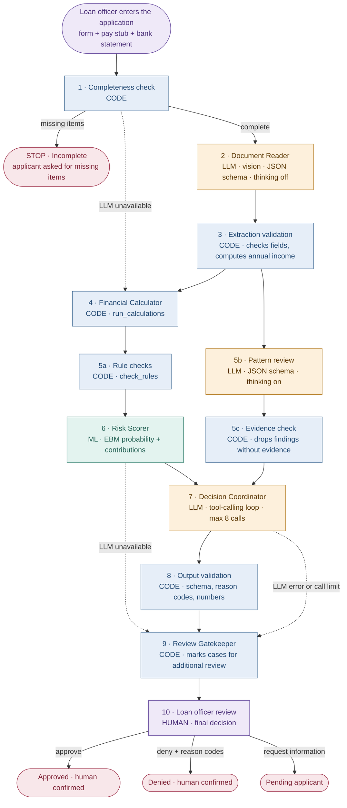
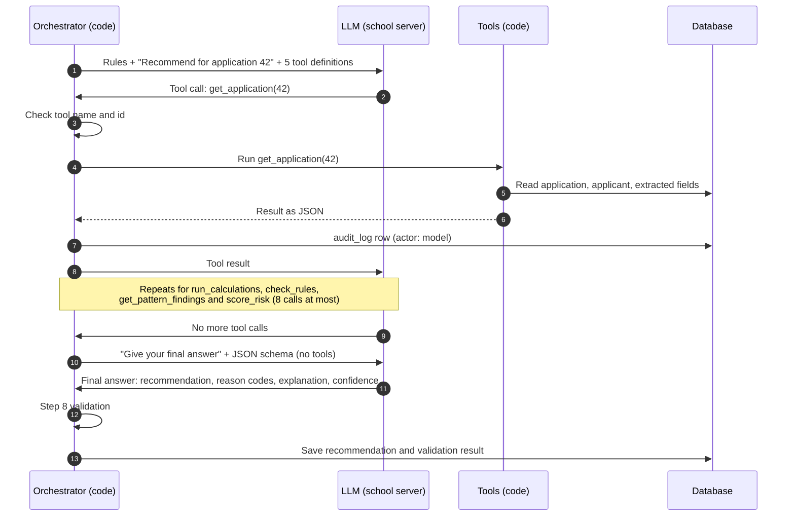

# Loan Decision Support System

A prototype that helps a loan officer review loan applications. It reads the applicant's pay
stub and bank statement with a vision LLM, runs the financial calculations and rule checks in
plain code, estimates the probability of default with an Explainable Boosting Machine (EBM), and
has an LLM write a recommendation from those results through read-only tools. Everything is
stored in a serverless SQLite database and shown in a Streamlit dashboard.

> **A loan officer always makes the final decision.** The system recommends; it never approves or
> denies a loan. Only an officer's action on the review page records a decision.

> Prototype built on a synthetic Kaggle dataset (`udaymalviya/bank-loan-data`) and generated
> sample documents. Results are not real-world accuracy claims.

---

## Screenshots

Add these images under `docs/` (not included yet):

| File | Shows |
|---|---|
| `docs/home.png` | Home page with the assistant panel |
| `docs/portfolio-insights.png` | Portfolio overview, Borrower insights tab |
| `docs/model-shapes.png` | Model page: calibration and a shape function |
| `docs/score-workflow.png` | Score an applicant: the workflow progress display |
| `docs/review-queue.png` | Officer review queue with recommendations and the waterfall |
| `docs/audit-log.png` | Audit log page |

## Features

- **Document Reader:** a vision LLM extracts fields from a pay stub and a bank statement (PDF,
  PNG or JPG) with a JSON schema; code validates every field and computes annual income.
- **Financial Calculator and rule checks** in plain code: loan-to-income, monthly payment,
  payment-to-income, and seven rules with thresholds from the dataset analysis.
- **Pattern review:** an LLM looks for inconsistencies across documents; code keeps only findings
  whose cited document fields exist.
- **Risk Scorer:** an EBM gives a default probability and each feature's contribution, shown as
  a waterfall from the baseline to the applicant's score.
- **Decision Coordinator:** an LLM writes a recommendation (approve, deny or refer) by calling
  five read-only tools; code validates the output, including every number in the explanation.
- **Review Gatekeeper:** marks cases for additional review (critical flags, failed validation,
  unverified extraction, low confidence, LLM errors). Every case goes to the officer.
- **Officer review queue:** recommendations, flags, documents with tamper check, extracted fields
  the officer can confirm or correct, and the decision form.
- **Model page:** ROC, calibration, score distribution, confusion matrix, shape functions,
  interaction heatmaps, feature importance and the fairness report.
- **Borrower insights:** who borrows and who defaults, default rate across ordered groups and
  categories, loan size by purpose, and how many borrowers cross each rule limit.
- **Assistant chat panel** on every page: answers questions about the data, the model and the
  selected application with read-only tools; it can't make or change decisions.
- **Returning applicants** keep one applicant record across applications.
- **Audit log** of every action by code, model and officers, append-only (enforced by database
  triggers).

## Workflow



| Step | Who | What happens |
|---|---|---|
| 1 Completeness check | Code | Required form fields, plus a pay stub and a bank statement that pass the type and size checks (PDF/PNG/JPG, ≤ 10 MB). Missing items stop the application as `stopped_incomplete`. |
| 2 Document Reader | LLM | Page images (PDFs rendered with pypdfium2, cropped to the printed content) go to the vision model with a JSON schema per document type. It copies what is printed and never calculates. |
| 3 Extraction validation | Code | Schema, types, plausible dates, page numbers, required fields. Computes annual income = gross pay × pay periods per year. Failures set `needs_review`. |
| 4 Financial Calculator | Code | Loan-to-income, monthly payment (36 months if no term), payment-to-income. |
| 5a Rule checks | Code | Seven rules (see below); `INCOME_MISMATCH` compares stated income with the pay stub. |
| 5b Pattern review | LLM | Looks across the extracted fields and the form for inconsistencies. |
| 5c Evidence check | Code | Keeps a finding only if every cited document and field exists and its description states no number absent from the data. Kept findings become `warning` flags; the LLM can't create critical flags. |
| 6 Risk Scorer | ML | The EBM's default probability and per-term contributions. |
| 7 Decision Coordinator | LLM | Reads the stored results through five tools and writes a recommendation, reason codes, a short explanation and a confidence. |
| 8 Output validation | Code | Schema, allowed reason codes, every number in the explanation traced to a tool result, and consistency (no approve with a critical flag or probability ≥ 0.5; no deny with no flags and probability < 0.2). |
| 9 Review Gatekeeper | Code | Marks the case for additional review when any trigger applies and lists the reasons. Sets the status to `in_review`. |
| 10 Officer review | Human | Approve, deny (reason codes required) or request information. Recorded in `officer_reviews` and the audit log. |

If the LLM server is unavailable, the application is still saved with calculations, rule checks
and the risk score, recommended `refer`, and marked `LLM_UNAVAILABLE`.

## How the LLM uses tools



**Decision Coordinator tools**

| Tool | Returns | Wraps |
|---|---|---|
| `get_application` | Form data, loan request, the applicant's earlier applications, documents with extracted fields, page numbers and `needs_review` markers | Database read |
| `run_calculations` | Loan-to-income, monthly payment, payment-to-income, with inputs and assumptions | `run_calculations()` |
| `check_rules` | Rule flags with value and limit, and the documented income used | `check_rules()` with `documented_income` from extraction |
| `get_pattern_findings` | Verified pattern findings with the fields they cite | Results of step 5b/5c |
| `score_risk` | Default probability, baseline, contributions, top drivers and protective factors, model version | `RiskScorer.score()` |

**Assistant chat tools** (the panel on every page)

| Tool | Returns |
|---|---|
| `get_application` | Same as the Coordinator's tool |
| `get_recommendation` | The stored recommendation, validation result and review reasons |
| `score_risk` | Same as the Coordinator's tool (stored result) |
| `portfolio_stats` | Count and default rate for one variable from a fixed list, optionally split by a second; a fixed query in code, never model-written SQL |
| `explain_feature` | The shape-function summary for one model feature, from the model's `.json` |
| `get_rules` | The `RULES` thresholds and what each flag means |

**Tool design rules**

- **Only `application_id`.** Coordinator tools take nothing else, so the model can't feed its own
  numbers into a calculation; every number it sees comes from code. On pages 3 and 4 the
  assistant's application tools use the application on screen.
- **Stored results.** Tools read what the workflow saved. If a result is missing, the tool
  computes it with the same function, saves it and returns it.
- **Read-only.** Tools never write decisions or change an application's status.
- **Bounded.** The orchestrator checks every call (known tool, the current application only);
  anything else returns an error to the model and counts toward the limit: **8 calls** for the
  Coordinator, **6** per assistant question. Every LLM call and tool call writes an `audit_log`
  row with actor `model` (model name, purpose, duration, tool calls), never the API key or
  document images.
- **Numbers are checked.** Code compares every number in the Coordinator's explanation, a pattern
  finding or an assistant answer with the tool results (allowing normal rounding). A failed
  Coordinator check marks the case for review; a failed assistant answer is shown with a warning.

## Architecture

```
loan_system/
├── db.py               SQLAlchemy models, get_engine() (SQLite settings, triggers), load_historical(), log()
├── calculations.py     Financial Calculator and rule checks (RULES)
├── train_ebm.py        Target check, EBM training, fairness report, graph data for the Model page
├── risk_scorer.py      RiskScorer and latest_model_path()
├── llm.py              The one client for the school LLM server (Ollama API)
├── documents.py        Document storage (uploads/<application_id>/), SHA-256, page rendering
├── document_reader.py  Workflow steps 2 and 3
├── pattern_review.py   Workflow steps 5b and 5c
├── coordinator.py      Workflow step 7: tools and the bounded tool-calling loop
├── validation.py       Number check, step 8 output validation, step 9 gatekeeper
├── workflow.py         Steps 1 to 9 in order, used by the dashboard and the evaluation
├── assistant.py        The chat assistant and its read-only tools
├── make_samples.py     Fictional test documents and an answer key (samples/)
├── load_data.py        Loads the Kaggle dataset into loans.db (provided)
├── app/Home.py, app/shared.py, app/pages/1_…5_…   The Streamlit dashboard
├── models/             Trained models (git-ignored)
├── models_experiments/ Experiment models (git-ignored)
├── uploads/            Applicant documents (git-ignored)
└── samples/            Generated sample documents (git-ignored)
```

**The 11 tables** (one SQLite file, `loans.db`)

| Table | Holds |
|---|---|
| `historical_loans` | The 45,000-row training dataset, loaded by `load_data.py` |
| `applicants` | One row per person (latest profile); age and gender are stored for fairness checks only |
| `applications` | One row per loan request, with status and current workflow step |
| `documents` | File path, original name, type, size, SHA-256 and page count (not the file) |
| `extracted_fields` | Each extracted value with its page, the model, `needs_review` and `verified_by_human` |
| `calculations` | Each metric with its inputs, formula and assumptions |
| `flags` | Rule and pattern flags with severity and evidence |
| `risk_scores` | Model version, default probability and every term's contribution |
| `recommendations` | approve/deny/refer, reason codes, explanation, confidence, validation result, review marking and reasons |
| `officer_reviews` | The officer's decision: the only place a final decision is recorded |
| `audit_log` | Every action by code, model, tools and officers; append-only (ORM guard and SQLite triggers) |

## Data

Kaggle dataset `udaymalviya/bank-loan-data`: 45,000 rows, 14 columns, synthetic. `loan_status = 1`
means default (confirmed by the target check: status 1 has higher interest rates, higher
loan-to-income and lower credit scores).

**Cleaning decision.** All 22,858 applicants with `previous_loan_defaults_on_file = "Yes"` have
`loan_status = 0`, an artifact of how the data was generated. Kept as is, the model would learn
that a previous default lowers risk. Training and analysis use only the 22,142 rows with "No"
(default rate 45.2%), the column is not a model feature, and prior defaulters are sent to the
officer by the critical `PREVIOUS_DEFAULT_ON_FILE` rule. `historical_loans` keeps all rows.

| Variable | Default rate below the limit | Default rate past the limit | Limit |
|---|---|---|---|
| Credit score | 56.9% (550 to 599) | 74.0% (500 to 549) | below 550 |
| Loan-to-income | 50.1% (0.20 to 0.25) | 87.1% (0.25 to 0.30) | 0.25 or above |
| Payment-to-income (36-month term) | 53.1% (0.075 to 0.10) | 86.8% (0.10 to 0.125) | 0.10 or above |

A band is high risk when its default rate is at least 1.5 times the cleaned average (67.7%);
the limit is where the high-risk bands start.

## The model

An **Explainable Boosting Machine** is a generalized additive model: the log-odds of default is a
baseline plus one learned shape function per feature, plus a few pairwise interaction terms. Each
term is a lookup table, so the score for any applicant is exactly the baseline plus the listed
contributions. That is what the waterfall shows, and the Model page draws every shape function.

**Features (10):** education, income, employment experience, home ownership, loan amount, loan
intent, interest rate, loan-to-income, credit history length, credit score. **Never used:**
gender and age (protected; fairness report only) and the previous-default column (data artifact).

**Variant chosen.** Four variants were trained on the same split. The rule picks the simplest
variant within 0.01 AUC of the best with no fairness ratio below 0.8 for any group of 100 or more.

| Variant | AUC | Brier | Terms | Lowest fairness ratio (n ≥ 100) |
|---|---|---|---|---|
| **a: default settings (chosen)** | **0.9413** | 0.0937 | 40 | 0.939 |
| b: no interactions | 0.9202 | 0.1109 | 10 | 0.918 |
| c: b without the two age proxies | 0.9204 | 0.1108 | 8 | 0.928 |
| d: c without interest rate | 0.8769 | 0.1411 | 7 | 0.946 |

**Test-set metrics** (4,429 loans): AUC 0.9413, accuracy at 0.5 86.7%, Brier score 0.0937.
At the 0.5 threshold it catches 79.4% of defaults and flags 7.3% of repaid loans.

**Calibration.** In every band of predicted probability, the actual default rate is within
0.084 of the average prediction (largest gap at 0.7-0.8: 0.751 predicted, 0.835 actual).

**Fairness** (share not flagged high risk, divided by the largest group's): female 1.014,
male 1.000; under 25 0.939, 25-34 1.000, 35-49 1.050, 50+ 1.113 (small sample, 56 people).
No group falls below the four-fifths line. Work experience (+0.96) and credit history length
(+0.86) correlate strongly with age; dropping them (variant c) cost 0.021 AUC with little fairness
change.

## LLM evaluation

The Document Reader on the 20 generated samples (40 documents, `qwen3.5:35b`): **100% field
accuracy (200/200), 100% page accuracy, 100% valid JSON**, annual income correct for 20/20.
Cropping page images to their content was essential: on full pages, bank statement balances came
back null (72.5% accuracy).

Full workflow, one sample per model (S09, a planted income mismatch):

| Model | Extraction field accuracy | Valid JSON | Planted mismatches caught | False mismatch flags | Validation pass | Seconds / application |
|---|---|---|---|---|---|---|
| `qwen3.5:latest` | 10/10 | 2/2 | 1/1 | not tested | 1/1 | 101 |
| `qwen3.5:35b` | 10/10 | 2/2 | 1/1 | not tested | 0/1 | 61 |

The dashboard uses **`qwen3.5:latest`** (`LLM_MODEL_ACTIVE`), chosen by the rule: the smaller
model is used if it is within 5 points on extraction, catches at least as many planted mismatches
and is within 5 points on validation. One sample is thin evidence; see `BUILD_LOG.md`.

## Rules and thresholds

| Flag | Condition | Severity | Where the limit came from |
|---|---|---|---|
| `INCOME_MISSING` | income zero, negative or missing | critical | Approved by the project owner (ratios can't be computed) |
| `PAYMENT_TO_INCOME_HIGH` | payment-to-income ≥ 0.10 | warning | Dataset analysis: default rate jumps from 53% to 87% (36-month term) |
| `LOAN_TO_INCOME_HIGH` | loan-to-income ≥ 0.25 | warning | Dataset analysis: default rate jumps from 50% to 87% |
| `CREDIT_SCORE_BELOW_MINIMUM` | credit score < 550 | critical | Dataset analysis: 74% default below 550 (600 would be stricter) |
| `PREVIOUS_DEFAULT_ON_FILE` | previous default = "Yes" | critical | Replaces the column removed from the model |
| `RATIO_INCONSISTENT` | form loan-to-income differs from calculated by > 0.02 | warning | Rounding allowance |
| `INCOME_MISMATCH` | pay stub income differs from stated income by > 15% | critical | Judgment call; not testable with this dataset |
| pattern flags | verified pattern-review finding | warning | LLM finding, kept only with valid evidence |

Thresholds live in `RULES` in `calculations.py` and change only with the project owner's
approval.

## Setup

Requirements: Python 3.11+ on Windows, macOS or Linux. No database server: SQLite is built in.

```powershell
python -m venv .venv
.venv\Scripts\activate          # macOS/Linux: source .venv/bin/activate
pip install -r requirements.txt

copy .env.example .env          # then fill in the values (never commit .env)
python load_data.py                          # once: loads 45,000 rows into loans.db
python train_ebm.py --check                  # confirm loan_status = 1 means default
python train_ebm.py --target-means default   # train once (about 70 seconds)
streamlit run app/Home.py
```

**Connecting the school server.** In `.env`, set `LLM_BASE_URL` to the server address (for
example `https://server:11434`), `LLM_API_KEY` to your key, and the model names
(`LLM_MODEL`, `LLM_MODEL_FINAL`, `LLM_MODEL_ACTIVE`). `LLM_NUM_CTX` (default 32768) and
`LLM_TIMEOUT_SECONDS` (default 120) apply to every call. The server must speak Ollama's API
(`/api/tags`, `/api/chat`) with `Authorization: Bearer <key>`. Without it, the dashboard still
works: LLM steps are skipped and applications are marked `LLM_UNAVAILABLE`.

Optional: `python make_samples.py` writes 20 fictional pay stubs and bank statements (5 with a
planted income mismatch) and an answer key to `samples/` for testing.

`loans.db`, `.env`, `models/`, `models_experiments/`, `uploads/`, `samples/` and any CSV are
git-ignored; everyone who clones the project loads the data and trains the model themselves.

## Limitations and responsible use

- **Synthetic data.** The dataset and sample documents are generated; accuracy figures describe
  this prototype, not real lending.
- **No true DTI.** There is no existing-debt column, so loan-to-income and payment-to-income stand
  in for debt-to-income; payment-to-income understates the real burden.
- **Assumed term.** With no term given, payments assume 36 months, and the assumption is stored
  with each result.
- **Demographics are never used for decisions.** Gender and age are excluded from the model and
  appear only in the fairness report and the Borrower insights tab. Work experience and credit
  history length track age closely and are model inputs; the fairness report watches the effect.
- **LLM limits.** The LLM can misread documents (real scans will do worse than the clean
  samples), miss inconsistencies, or describe correct numbers inaccurately. That is why code
  validates every extraction and number, the gatekeeper marks uncertain cases, the officer can
  verify fields against the documents, and the officer decides.
- **The LLM never produces a number and never decides.** Numbers come from extraction, the
  calculator, the rules or the model; recommendations are suggestions.
- Applicant documents are sent only to the configured school server.

## Project status

Phase 1 (data, database, calculations, EBM, dashboard) and phase 2 (review fixes, model
experiment, model graphs, returning applicants, the LLM layer, dashboard additions) are complete.
Every build step, test result, decision and open item is recorded in
[`BUILD_LOG.md`](BUILD_LOG.md). The specifications are [`CLAUDE.md`](CLAUDE.md) and
[`CLAUDE2.md`](CLAUDE2.md).
