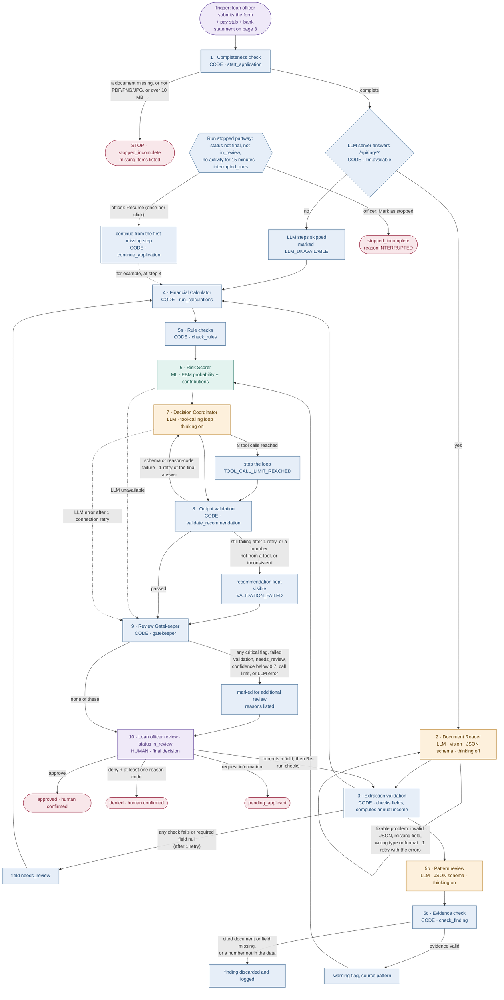
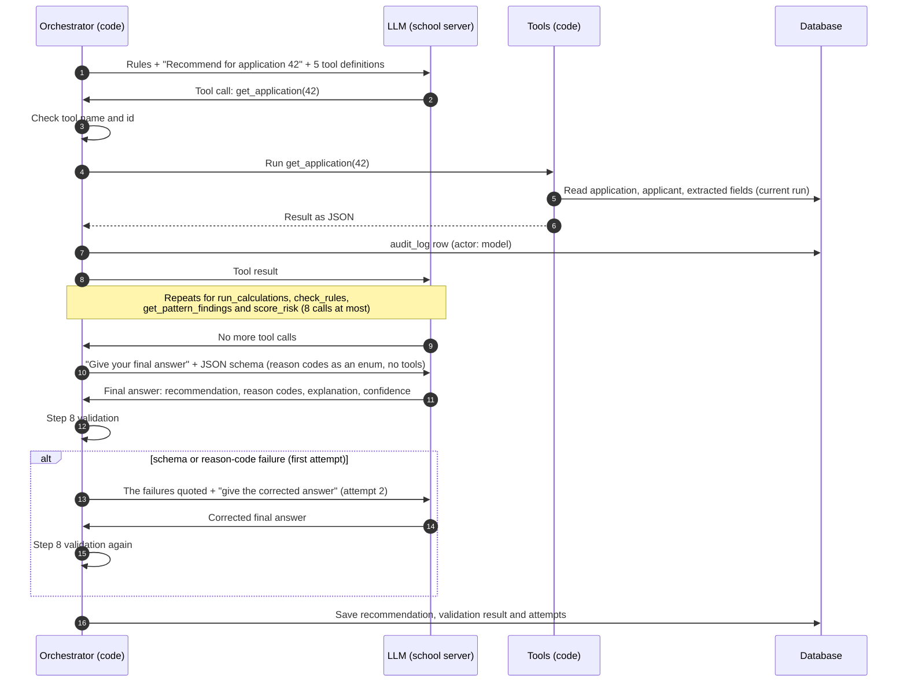
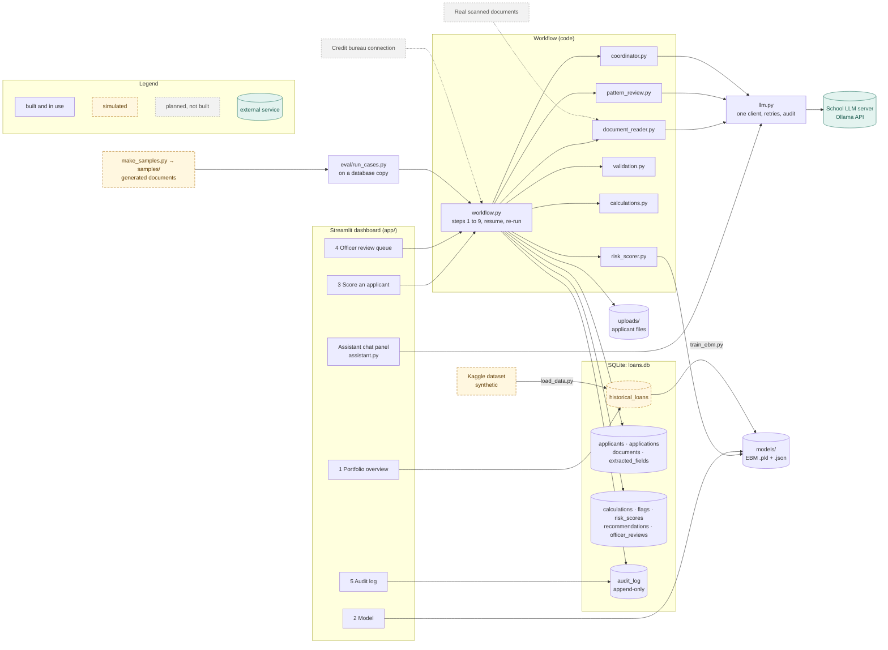

# Loan Decision Support System

A prototype that helps a loan officer review loan applications. It reads the applicant's pay
stub and bank statement with a vision LLM, runs the financial calculations and rule checks in
plain code, estimates the probability of default with an Explainable Boosting Machine (EBM), and
has an LLM write a recommendation from those results through read-only tools. Everything is
stored in a serverless SQLite database and shown in a Streamlit dashboard.

> **A loan officer always makes the final decision.** The system recommends; it never approves or
> denies a loan. Only an officer's action on the review page records a decision.

> Prototype built on a synthetic Kaggle dataset (`udaymalviya/bank-loan-data`) and generated
> sample documents. Results are not real-world accuracy claims.

---

## Screenshots

Add these images under `docs/` (not included yet):

| File | Shows |
|---|---|
| `docs/home.png` | Home page with the assistant panel |
| `docs/portfolio-insights.png` | Portfolio overview, Borrower insights tab |
| `docs/model-shapes.png` | Model page: calibration and a shape function |
| `docs/score-workflow.png` | Score an applicant: the workflow progress display |
| `docs/review-queue.png` | Officer review queue with recommendations and the waterfall |
| `docs/audit-log.png` | Audit log page |

## Features

- **Document Reader:** a vision LLM extracts fields from a pay stub and a bank statement (PDF,
  PNG or JPG) with a JSON schema; code validates every field and computes annual income.
- **Financial Calculator and rule checks** in plain code: loan-to-income, monthly payment,
  payment-to-income, and seven rules with thresholds from the dataset analysis.
- **Pattern review:** an LLM looks for inconsistencies across documents; code keeps only findings
  whose cited document fields exist.
- **Risk Scorer:** an EBM gives a default probability and each feature's contribution, shown as
  a waterfall from the baseline to the applicant's score.
- **Decision Coordinator:** an LLM writes a recommendation (approve, deny or refer) by calling
  five read-only tools; code validates the output, including every number in the explanation.
- **Review Gatekeeper:** marks cases for additional review (critical flags, failed validation,
  unverified extraction, low confidence, LLM errors). Every case goes to the officer.
- **Officer review queue:** recommendations, flags, documents with tamper check, extracted fields
  the officer can confirm or correct, **Re-run checks** after a correction, and the decision form.
- **Re-run checks:** after confirming or correcting an extracted field, the officer reruns steps
  3 to 9 with the corrected values (documents are not read again). New results are added and the
  earlier ones kept; the view says the results were recalculated, by whom, and what changed.
- **Model page:** ROC, calibration, score distribution, confusion matrix, shape functions,
  feature importance and the fairness report (interaction heatmaps appear only for a model with
  pair terms; the main model has none).
- **Borrower insights:** who borrows and who defaults, default rate across ordered groups and
  categories, loan size by purpose, and how many borrowers cross each rule limit.
- **Assistant chat panel** on every page: answers questions about the data, the model and the
  selected application with read-only tools; it can't make or change decisions.
- **Returning applicants** keep one applicant record across applications.
- **Interrupted runs:** a run that stops partway (closed browser, crash, lost server) shows up
  on the review page with **Resume** (continue from the first missing step; finished steps are
  not redone) and **Mark as stopped**.
- **Audit log** of every action by code, model and officers, append-only (enforced by database
  triggers).

## Workflow



**How the workflow is controlled.** Steps 1 to 9 run as a fixed sequence in code
(`workflow.continue_application`), and every branch above is an `if` in code with the condition
shown. The only place a model chooses what to do next is the Decision Coordinator inside step 7,
which picks among five read-only tools for at most 8 calls. Lending needs a predictable,
auditable order: every application passes the same checks in the same order, and the audit log
shows exactly which ran. Letting a model choose tools adds value only where it gathers evidence
for its explanation; it can't skip a check, reorder steps, or change a result.

**Branch conditions**

| Branch | Exact condition | Checked by | Outcome |
|---|---|---|---|
| Incomplete application | A required document is missing, or a file is not PDF/PNG/JPG by its signature, over 10 MB, or an unreadable PDF | `workflow.start_application`, `documents.save_document` | `stopped_incomplete`, missing items listed; nothing scored |
| LLM unavailable | `GET /api/tags` fails, or LLM steps are turned off | `llm.available`, `workflow.continue_application` | Steps 2, 5b and 7 skipped; `LLM_UNAVAILABLE` |
| Connection retry | Timeout or connection error on an LLM call | `llm.chat` | 1 retry; then `LLMError` (recorded as an LLM error) |
| Document Reader retry | Reply has a fixable problem: invalid JSON, missing field, wrong type, pay period not in the list, non-ISO date, page out of range | `document_reader.fixable_problems` | 1 retry quoting the problems |
| Field needs review | Any step 3 check fails after the retry, or a required field is null | `document_reader.validate` | `needs_review` on the field; `EXTRACTION_NEEDS_REVIEW` at the gatekeeper |
| Rule flags | The conditions in "Rules and thresholds" | `calculations.check_rules` | Warning or critical flags |
| Finding discarded | A cited document or field doesn't exist, no evidence, or the description states a number not in the data | `pattern_review.check_finding` | Discarded and logged; kept findings are warning flags |
| Invalid tool call | Unknown tool name, an argument other than `application_id`, or another application's id | `coordinator.run_tool` | Error returned to the model; counts toward the limit |
| Tool-call limit | 8 tool calls reached | `coordinator.coordinate` | Loop stops; final answer still requested; `TOOL_CALL_LIMIT_REACHED` |
| Final-answer retry | Step 8 reports a `SCHEMA` or `REASON_CODE` failure on the first attempt | `validation.fixable_failures` | 1 retry quoting the failures |
| Validation failed | After the retry: schema or reason-code failure, a number not from a tool, approve with a critical flag or probability ≥ 0.5, or deny with no flags and probability < 0.2 | `validation.validate_recommendation` | Recommendation kept visible; `VALIDATION_FAILED: …` |
| Marked for review | Any critical flag, failed validation, a field needing review, confidence below 0.7, the tool-call limit, or an LLM error | `validation.gatekeeper` | `marked_for_additional_review`, reasons listed; always `in_review` |
| Interrupted run | Status neither final nor `in_review`, and no audit row for 15 minutes | `workflow.interrupted_runs` | Listed on page 4 with Resume and Mark as stopped |
| Resume | Officer clicks Resume (name required) | `workflow.resume` | Continues once from the first missing step |
| Mark as stopped | Officer clicks Mark as stopped (name required) | `workflow.mark_stopped` | `stopped_incomplete`, reason `INTERRUPTED` |
| Re-run checks | Officer clicks Re-run checks after confirming or correcting a field (name required; status `in_review`) | `workflow.rerun_checks` | Steps 3 to 9 again; new rows added; changes logged |
| Officer decision | Approve; deny with at least one reason code; or request information | page 4 | `approved`, `denied` or `pending_applicant` |

**Steps**

| Step | Who | What happens |
|---|---|---|
| 1 Completeness check | Code | Required form fields, plus a pay stub and a bank statement that pass the type and size checks (PDF/PNG/JPG, ≤ 10 MB). Missing items stop the application as `stopped_incomplete`. |
| 2 Document Reader | LLM | Page images (PDFs rendered with pypdfium2, cropped to the printed content) go to the vision model with a JSON schema per document type. It copies what is printed and never calculates. A reply with a problem the model can fix (invalid JSON, a missing field, a wrong type or format, a page out of range) gets **one retry** that quotes the problems; if the retry fails too, the fields are marked `needs_review`. |
| 3 Extraction validation | Code | Schema, types, plausible dates, page numbers, required fields. Computes annual income = gross pay × pay periods per year. Failures set `needs_review`. |
| 4 Financial Calculator | Code | Loan-to-income, monthly payment (36 months if no term), payment-to-income. |
| 5a Rule checks | Code | Seven rules (see below); `INCOME_MISMATCH` compares stated income with the pay stub. |
| 5b Pattern review | LLM | Looks across the extracted fields and the form for inconsistencies. |
| 5c Evidence check | Code | Keeps a finding only if every cited document and field exists and its description states no number absent from the data. Kept findings become `warning` flags; the LLM can't create critical flags. |
| 6 Risk Scorer | ML | The EBM's default probability and per-term contributions. |
| 7 Decision Coordinator | LLM | Reads the stored results through five tools (at most 8 calls) and writes a recommendation, reason codes, a short explanation and a confidence. The answer's JSON schema lists this application's allowed reason codes as an `enum`. |
| 8 Output validation | Code | Schema, allowed reason codes (a second safeguard behind the enum), every number in the explanation traced to a tool result, and consistency (no approve with a critical flag or probability ≥ 0.5; no deny with no flags and probability < 0.2). A schema or reason-code failure gets **one retry** of the final answer with the failures quoted; if it fails again, the recommendation stays visible and the case is marked `VALIDATION_FAILED`. Number and consistency failures are not retried. |
| 9 Review Gatekeeper | Code | Marks the case for additional review when any trigger applies and lists the reasons. Sets the status to `in_review`. |
| 10 Officer review | Human | Confirm or correct extracted fields (`verified_by_human`), optionally **Re-run checks** (steps 3 to 9 again with the corrected values, new rows added, old rows kept, changes logged), then approve, deny (reason codes required) or request information. The decision is recorded in `officer_reviews` and the audit log. |

If the LLM server is unavailable, the application is still saved with calculations, rule checks
and the risk score, recommended `refer`, and marked `LLM_UNAVAILABLE`.

| Recovery | Who | What happens |
|---|---|---|
| Interrupted run | Code | A run whose status is neither final nor `in_review` and has had no audit activity for 15 minutes (`INTERRUPTED_AFTER_MINUTES`) is listed under **Interrupted runs** on the review page. |
| Resume | Human, then code | The officer (name required) resumes it once: the workflow continues from the first step whose result is missing. |
| Mark as stopped | Human | The officer (name required) closes it as `stopped_incomplete` with reason `INTERRUPTED`. |

## Run state and recovery

**What is carried between steps, and where.** Nothing is kept in memory between steps: each
step reads what earlier steps saved in the database and writes its own results there.

| Carried | Stored in |
|---|---|
| Form values the application was scored with | `audit_log` (the `intake` row's `form`) |
| Documents | files in `uploads/<application_id>/`; path, SHA-256 and page count in `documents` |
| Extracted fields and the computed annual income | `extracted_fields` (newest row per field is current) |
| Calculations, flags, risk score | `calculations`, `flags`, `risk_scores` |
| The Coordinator's answer and the validation result | `audit_log` (`recommendation written`, `output_validation`) |
| Recommendation and review marking | `recommendations` |

**How progress and errors are tracked.** `applications.status` is `submitted` while a run is in
progress and becomes `in_review` at the gatekeeper (or `stopped_incomplete` at step 1).
`applications.current_step` is saved as each step starts, so it shows where a run stopped. Every
step commits its results together with an `audit_log` row as soon as it finishes; every LLM
call, tool call and failure (`LLM steps skipped`, `pattern review failed`, `coordinator failed`)
is also an audit row.

**What happens when a run stops partway.** Steps that finished stay saved, with their files and
audit rows. A step that was cut off saves nothing (its results and audit rows are written in one
transaction), so it runs again in full on Resume. The Document Reader commits one document at a
time. `workflow.continue_application()` checks each step against the current run (saved rows and
audit rows) and runs only the missing ones; the same function serves a fresh run, a Resume and a
Re-run after a correction. If a resumed run is interrupted again, it shows as interrupted again;
Resume never loops on its own.


## How the LLM uses tools



**Decision Coordinator tools**

| Tool | Returns | Wraps |
|---|---|---|
| `get_application` | Form data, loan request, the applicant's earlier applications, documents with extracted fields, page numbers and `needs_review` markers | Database read |
| `run_calculations` | Loan-to-income, monthly payment, payment-to-income, with inputs and assumptions | `run_calculations()` |
| `check_rules` | Rule flags with value and limit, and the documented income used | `check_rules()` with `documented_income` from extraction |
| `get_pattern_findings` | Verified pattern findings with the fields they cite | Results of step 5b/5c |
| `score_risk` | Default probability, baseline, contributions, top drivers and protective factors, model version | `RiskScorer.score()` |

**Assistant chat tools** (the panel on every page)

| Tool | Returns |
|---|---|
| `get_application` | Same as the Coordinator's tool |
| `get_recommendation` | The stored recommendation, validation result and review reasons |
| `score_risk` | Same as the Coordinator's tool (stored result) |
| `portfolio_stats` | Count and default rate for one variable from a fixed list, optionally split by a second; a fixed query in code, never model-written SQL |
| `explain_feature` | The shape-function summary for one model feature, from the model's `.json` |
| `get_rules` | The `RULES` thresholds and what each flag means |

**Tool design rules**

- **Only `application_id`.** Coordinator tools take nothing else, so the model can't feed its own
  numbers into a calculation; every number it sees comes from code. On pages 3 and 4 the
  assistant's application tools use the application on screen.
- **Stored results.** Tools read what the workflow saved. If a result is missing, the tool
  computes it with the same function, saves it and returns it.
- **Read-only.** Tools never write decisions or change an application's status.
- **Reason codes are an enum.** The final-answer schema is built per application: its
  `reason_codes` may only be this application's flag codes, its `MODEL_DRIVER:<term>` codes and
  the general reasons. Step 8 checks them again.
- **Retry limits.** Connection or timeout errors: 1 retry per call. Invalid output (Document
  Reader reply, Coordinator final answer): 1 retry with the error message. So no call is
  attempted more than twice for either reason. Every attempt is an audit row with its attempt
  number and, for a retry, the error that caused it.
- **Bounded.** The orchestrator checks every call (known tool, the current application only);
  anything else returns an error to the model and counts toward the limit: **8 calls** for the
  Coordinator, **6** per assistant question. Every LLM call and tool call writes an `audit_log`
  row with actor `model` (model name, purpose, duration, tool calls), never the API key or
  document images.
- **Numbers are checked.** Code compares every number in the Coordinator's explanation, a pattern
  finding or an assistant answer with the tool results (allowing normal rounding). A failed
  Coordinator check marks the case for review; a failed assistant answer is shown with a warning.

## Architecture



Dashed orange boxes are simulated (the synthetic Kaggle dataset and the generated sample
documents); dotted grey boxes are planned and not built (a credit bureau connection, real scanned
documents).

```
loan_system/
├── db.py               SQLAlchemy models, get_engine() (SQLite settings, triggers), load_historical(), log()
├── calculations.py     Financial Calculator and rule checks (RULES)
├── train_ebm.py        Target check, EBM training, fairness report, graph data for the Model page
├── risk_scorer.py      RiskScorer and latest_model_path()
├── llm.py              The one client for the school LLM server (Ollama API)
├── documents.py        Document storage (uploads/<application_id>/), SHA-256, page rendering
├── document_reader.py  Workflow steps 2 and 3
├── pattern_review.py   Workflow steps 5b and 5c
├── coordinator.py      Workflow step 7: tools and the bounded tool-calling loop
├── validation.py       Number check, step 8 output validation, step 9 gatekeeper
├── workflow.py         Steps 1 to 9 in order, used by the dashboard and the evaluation
├── assistant.py        The chat assistant and its read-only tools
├── make_samples.py     Fictional test documents and an answer key (samples/)
├── eval/               run_cases.py (evaluation on a database copy), README, results/
├── load_data.py        Loads the Kaggle dataset into loans.db (provided)
├── app/Home.py, app/shared.py, app/pages/1_…5_…   The Streamlit dashboard
├── models/             Trained models (git-ignored)
├── models_experiments/ Experiment models (git-ignored)
├── uploads/            Applicant documents (git-ignored)
├── samples/            Generated sample documents (git-ignored)
├── requirements.txt, .env.example
└── BUILD_LOG.md        Every build step, test, decision and open item
```

**The 11 tables** (one SQLite file, `loans.db`)

| Table | Holds |
|---|---|
| `historical_loans` | The 45,000-row training dataset, loaded by `load_data.py` |
| `applicants` | One row per person (latest profile); age and gender are stored for fairness checks only |
| `applications` | One row per loan request, with status and current workflow step |
| `documents` | File path, original name, type, size, SHA-256 and page count (not the file) |
| `extracted_fields` | Each extracted value with its page, the model, `needs_review` and `verified_by_human` |
| `calculations` | Each metric with its inputs, formula and assumptions |
| `flags` | Rule and pattern flags with severity and evidence |
| `risk_scores` | Model version, default probability and every term's contribution |
| `recommendations` | approve/deny/refer, reason codes, explanation, confidence, validation result, review marking and reasons |
| `officer_reviews` | The officer's decision: the only place a final decision is recorded |
| `audit_log` | Every action by code, model, tools and officers; append-only (ORM guard and SQLite triggers) |

## Data

Kaggle dataset `udaymalviya/bank-loan-data`: 45,000 rows, 14 columns, synthetic. `loan_status = 1`
means default (confirmed by the target check: status 1 has higher interest rates, higher
loan-to-income and lower credit scores).

**Cleaning decision.** All 22,858 applicants with `previous_loan_defaults_on_file = "Yes"` have
`loan_status = 0`, an artifact of how the data was generated. Kept as is, the model would learn
that a previous default lowers risk. Training and analysis use only the 22,142 rows with "No"
(default rate 45.2%), the column is not a model feature, and prior defaulters are sent to the
officer by the critical `PREVIOUS_DEFAULT_ON_FILE` rule. `historical_loans` keeps all rows.

| Variable | Default rate below the limit | Default rate past the limit | Limit |
|---|---|---|---|
| Credit score | 56.9% (550 to 599) | 74.0% (500 to 549) | below 550 |
| Loan-to-income | 50.1% (0.20 to 0.25) | 87.1% (0.25 to 0.30) | 0.25 or above |
| Payment-to-income (36-month term) | 53.1% (0.075 to 0.10) | 86.8% (0.10 to 0.125) | 0.10 or above |

A band is high risk when its default rate is at least 1.5 times the cleaned average (67.7%);
the limit is where the high-risk bands start.

## The model

An **Explainable Boosting Machine** is a generalized additive model: the log-odds of default is a
baseline plus one learned shape function per feature. Each shape function is a lookup table, so
the score for any applicant is exactly the baseline plus one contribution per feature. That is
what the waterfall shows, and the Model page draws every shape function. The main model has no
interaction terms, so every contribution belongs to a single feature.

**Features (8):** education, income, home ownership, loan amount, loan intent, interest rate,
loan-to-income, credit score. **Never used:** gender and age (protected; fairness report only),
the previous-default column (data artifact), and employment experience and credit history
length (removed because they track age closely, see below).

**Variant chosen: c.** Four variants were trained on the same split (17,713 training and 4,429
test loans, `random_state=42`):

| Variant | AUC | Brier | Terms | Lowest fairness ratio (n ≥ 100) |
|---|---|---|---|---|
| a: EBM defaults (10 features, 30 interactions) | 0.9413 | 0.0937 | 40 | 0.939 |
| b: no interactions | 0.9202 | 0.1109 | 10 | 0.918 |
| **c: b without employment experience and credit history length (chosen)** | **0.9204** | **0.1108** | **8** | **0.928** |
| d: c without interest rate | 0.8769 | 0.1411 | 7 | 0.946 |

The written rule from phase 2 (simplest variant within 0.01 AUC of the best, no fairness ratio
below 0.8) picked variant a. The project team then chose **variant c**: it gives up 0.021 AUC
against variant a in exchange for a model with one readable term per feature and without the two
features that act as stand-ins for age. Compared with variant b, dropping the age proxies cost
nothing (AUC 0.9204 vs 0.9202).

**Test-set metrics** (4,429 loans): AUC 0.9204, accuracy at 0.5 84.3%, Brier score 0.1108.
At the 0.5 threshold it catches 79.0% of defaults (1,579 of 2,000) and flags 11.4% of repaid
loans (276 of 2,429); 85.1% of the loans it flags actually defaulted.

**Calibration.** In every band of predicted probability, the actual default rate is within
0.051 of the average prediction (largest gap at 0.5-0.6: 0.548 predicted, 0.498 actual, 201
loans).

**Fairness** (share not flagged high risk, divided by the largest group's): female 1.000,
male 1.000; under 25 0.928, 25-34 1.000, 35-49 1.021, 50+ 1.022 (small sample, 56 people).
No group falls below the four-fifths line.

**Age proxies.** Employment experience correlates +0.96 with age and credit history length
+0.86 (cleaned rows). They are not model inputs; the training script still reports the
correlations so the effect stays visible.

## Evaluation

`eval/run_cases.py` runs the workflow on test inputs, always on a copy of the database, and
writes Markdown and JSON results to `eval/results/<date>/` (see [`eval/README.md`](eval/README.md)).
Interpretations are drafts for the team to review.

### Test cases

The three cases the Milestone 2 requirement asks for come first.

| Case | Requirement | Expected | Actual (2026-10-11) | Result |
|---|---|---|---|---|
| Clean sample (S06), then a scripted officer approval | **1. Representative successful case** | Completes steps 1 to 9; approve or refer; validation passes; pauses at `in_review`; the officer's approval is written to `officer_reviews` and the status becomes `approved` | Not run: the school LLM server was unreachable | not run |
| Planted mismatch (S01) | **2. Different input condition / branch** | `INCOME_MISMATCH` critical flag; marked for additional review | Not run: the school LLM server was unreachable | not run |
| Text file renamed to `.pdf` | **3. Invalid or failing case** | Rejected by the file-signature check; stops at step 1 as `stopped_incomplete` | `stopped_incomplete`: "document: bank_statement (Only PDF, PNG and JPG files are accepted.)" | pass |
| Missing bank statement | Extra: failing case | Stops at step 1 as `stopped_incomplete` | `stopped_incomplete`, missing "document: bank_statement" | pass |
| LLM turned off | Extra: fallback path | Saved with calculations, rules and score; `refer`; `LLM_UNAVAILABLE` | `in_review`, `refer`, probability 0.6342, marked `LLM_UNAVAILABLE, EXTRACTION_NEEDS_REVIEW` | pass |
| Interrupted then resumed | Extra: recovery path | Completes with no step run twice | Stopped at `risk_scoring`, resumed to `in_review`, no step run twice | pass |

Without the LLM, a run takes about 0.02 seconds. Cases 1 and 2 need the school server (campus
network or VPN). An earlier run of the same path on sample S04 (build log, E6) took 65 seconds,
caught the planted mismatch, and passed validation.

### Document Reader accuracy

On the 20 generated samples (40 documents, `qwen3.5:35b`): **100% field accuracy (200/200),
100% page accuracy, 100% valid JSON**, annual income correct for 20 of 20. Cropping page images
to their printed content was essential: on full pages, bank statement balances came back null and
accuracy was 72.5% (145/200).

### Model comparison (provisional)

The comparison on all 20 samples (`eval/run_cases.py --compare qwen3.5:latest,qwen3.5:35b
--samples all`) has not run yet because the school server was unreachable. The current choice
comes from **one sample** (S09):

| Model | Extraction field accuracy | Valid JSON | Planted mismatches caught | Validation pass | Seconds / application |
|---|---|---|---|---|---|
| `qwen3.5:latest` | 10/10 | 2/2 | 1/1 | 1/1 | 101 |
| `qwen3.5:35b` | 10/10 | 2/2 | 1/1 | 0/1 | 61 |

The dashboard uses `qwen3.5:latest` (`LLM_MODEL_ACTIVE`), chosen by the rule from `CLAUDE2.md`:
use the smaller model if it is within 5 points on extraction, catches at least as many planted
mismatches, and its validation pass rate is not more than 5 points lower. One sample cannot
separate the models; treat this as provisional until the 20-sample run.

### Test data

`make_samples.py` builds the test documents from `historical_loans`. Everything below is read
from that script.

- **What a sample is.** One fictional applicant with a one-page pay stub and a two-page bank
  statement, as PDFs: 20 samples, 40 documents, in `samples/`. `samples/answer_key.json` holds,
  per sample, the historical row id, the fictional name, whether a mismatch is planted and its
  factor, the 11 form values taken from the historical row, and for each document the correct
  value and page number of every field the Document Reader extracts (plus net pay and the
  annual income code should compute).
- **How the applicants are chosen.** A random sample of 20 cleaned rows (no previous default),
  `random_state=42`; a second random generator with the same seed makes every other choice. With
  the fixed seed and a fixed PDF creation date, every run writes byte-identical files.
- **Names.** "First Last (sample Sxx)" from two fixed lists of 10; employers come from a list of
  10 fictional companies, banks from a list of 4 fictional banks. Employee IDs and account
  numbers are random digits (the account number is masked).
- **Pay stub.** The pay period is chosen at random among weekly, biweekly, semimonthly and
  monthly. Gross pay = stated income × factor ÷ periods per year (52, 26, 24, 12), rounded to the
  cent. Deductions are fixed shares of gross pay (federal 12%, state 4.5%, Social Security 6.2%,
  Medicare 1.45%) and net pay is gross minus deductions, so the reader must pick gross, not net.
  The pay date is 2026-09-25 (weekly, biweekly) or 2026-09-30 (semimonthly, monthly), and the pay
  period runs before it (for example 1 to 15 September for semimonthly).
- **Bank statement.** Statement period 1 to 30 September 2026. Page 1: account holder, masked
  account number, period, opening balance (random, 400 to 9,000) and closing balance. Page 2: six
  transactions on 3, 7, 15, 21, 28 and 29 September: two payroll deposits that add up to stated
  income ÷ 12, and four withdrawals (rent or mortgage at 25 to 35% of monthly income, groceries
  250 to 700, utilities 90 to 260, a card payment 100 to 900), then total deposits and total
  withdrawals. Closing = opening + deposits − withdrawals.
- **Watermark.** Every page carries "SAMPLE - NOT A REAL DOCUMENT" three times: a red header, a
  grey diagonal across the page, and the footer with the page number.
- **Planted mismatches.** 5 of the 20 samples, picked at random with the same seed: S01, S04,
  S08, S09 and S17. Only the pay stub changes: its income is 1.2 to 1.4 times stated income
  (factor drawn at random, kept in the answer key). The form and the bank statement stay at
  stated income, so the pay stub disagrees with both, which is the situation `INCOME_MISMATCH`
  and pattern review are meant to catch.
- **Limitations.** Clean, generated PDFs: no scans, blur, rotation, handwriting or stamps; one
  layout per document type; and every planted gap is 20% or more, far above the 15% limit, so no
  sample tests a borderline case.

## Step contracts

| Step | Input | Operation or responsibility | Output | Validation and failure behavior |
|---|---|---|---|---|
| 1 Completeness check | Form fields (`full_name`, `person_income`, `person_education`, `person_home_ownership`, `loan_amnt`, `loan_intent`, `loan_int_rate`, `credit_score`, `previous_loan_defaults_on_file`; optional `loan_percent_income`, `term_months`); pay stub and bank statement files | Create or update the `applicants` row, create the `applications` row, store each file | `applicants`, `applications` (`status = submitted`), `documents` (path, name, MIME type, size, SHA-256, pages), files in `uploads/<id>/`, audit `intake` (with the form) and `completeness_check` | Missing or rejected document: `status = stopped_incomplete`, missing items in the audit row. Missing form field: refused, nothing saved |
| 2 Document Reader | `documents` rows and their files; page images cropped to content | Vision LLM copies the printed fields into a JSON schema per document type (thinking off) | Raw reply (not stored); audit `document_reader` row per LLM call (model, attempt, retry reason, tokens) | Fixable problem: 1 retry with the errors. Connection error: 1 retry, then the document counts as unread (LLM error) |
| 3 Extraction validation | The reply; page count | Check schema, types, pay period, dates, pages; compute annual income = gross pay × periods per year | `extracted_fields` (value, page, confidence, `extraction_model`, `needs_review`), plus an `annual_income` row computed by code; audit `extraction_validation` | Any failed check or null required field: `needs_review = True`. On a re-run: annual income recomputed from the current fields as a new row |
| 4 Financial Calculator | Stored form values | `run_calculations`: loan-to-income, monthly payment, payment-to-income | `calculations` (metric, value, inputs, formula, assumptions); audit `calculations` | Income ≤ 0 or missing: ratios `None`; no term: 36 months assumed and recorded |
| 5a Rule checks | Form values, calculations, documented income (pay stub `annual_income`) | `check_rules` against `RULES` | `flags` (`source = rule`, severity, evidence with value and limit); audit `rule_check` | None needed: deterministic code |
| 5b Pattern review | Current extracted fields of every document, plus form values (no images) | LLM looks for inconsistencies (JSON schema, thinking on) | Findings (not stored directly); audit LLM row | Reply not valid JSON: no findings, logged. Connection failure: `pattern review failed`, LLM error |
| 5c Evidence check | Findings; the same data | `check_finding`: cited document and field exist; no number absent from the data | `flags` (`source = pattern`, `severity = warning`, description and cited values); audit `evidence_check` (kept and discarded) | Invalid findings discarded and logged; the LLM cannot create critical flags |
| 6 Risk Scorer | Form values (the 8 model features) | `RiskScorer.score` with the EBM in `models/` | `risk_scores` (model version, probability, contribution per term); audit `risk_scoring` | Missing feature: error; the scorer refuses a model whose features differ from `train_ebm.FEATURES` |
| 7 Decision Coordinator | `application_id` only; five read-only tools over the stored results of the current run | LLM tool loop (thinking on), then a final answer in a schema whose reason codes are an enum | Answer (recommendation, reason codes, explanation, confidence); audit LLM rows, one row per tool call, `recommendation written` | Invalid tool call: error to the model, counts toward the limit. 8 calls: loop stops, `TOOL_CALL_LIMIT_REACHED`. LLM error: `coordinator failed` |
| 8 Output validation | Answer; this run's tool results; flags; probability | `validate_recommendation`: schema, reason codes, every number traced to a tool result, consistency | Audit `output_validation` (failures, attempts) | Schema or reason-code failure: 1 retry of the final answer. Still failing, or a number or consistency failure: `VALIDATION_FAILED`, recommendation kept |
| 9 Review Gatekeeper | Flags, validation result, `needs_review` markers, confidence, call limit, LLM errors | `gatekeeper` decides whether to mark the case | `recommendations` (recommendation, reason codes, explanation, confidence, `passed_validation`, `marked_for_additional_review`, `review_reasons`); `status = in_review`; audit `gatekeeper` and `status` | Every case goes to the officer; without a usable LLM answer the recommendation is `refer` |
| 10 Loan officer review | Everything above, the documents (hash-checked), the officer's name | Verify or correct fields; optionally Re-run checks; decide | `extracted_fields.verified_by_human`; `officer_reviews` (decision, reason codes, notes); `status = approved / denied / pending_applicant`; audit rows `human:<name>` | Name always required; deny needs a reason code; a decision is refused if the case is no longer in review |

## Design decision records

| Decision | Rationale | Alternative | Trade-off | Evidence |
|---|---|---|---|---|
| **Model variant c** (8 features, no interactions) instead of variant a | One readable term per feature, and no features that act as stand-ins for age | Variant a: EBM defaults, 10 features, 30 interaction terms | AUC 0.9204 vs 0.9413 (−0.021), Brier 0.1108 vs 0.0937, accuracy 84.3% vs 86.7%; lowest fairness ratio 0.928 vs 0.939 | Same split (17,713 / 4,429 loans, `random_state=42`). Judged by: the phase 2 rule (simplest variant within 0.01 AUC of the best, no ratio below 0.8 for groups of 100+) picked a; the team overrode it for interpretability and age-proxy removal, accepting the AUC cost |
| **Crop page images to their content** before the Document Reader | The server downscales large images, so small print on mostly blank pages became unreadable | Send full rendered pages | A little image processing per page; nothing measurable lost | Same 40 documents: field accuracy 145/200 (72.5%) on full pages vs 200/200 (100%) cropped; page accuracy 75% vs 100%. Judged by: field accuracy against the answer key |
| **`qwen3.5:latest`** as the active model instead of `qwen3.5:35b` (provisional) | The decision rule prefers the smaller model when it is not worse | `qwen3.5:35b` | On the one sample, `latest` took longer (101 s vs 61 s, probably a cold start) | **One sample (S09) only**: extraction 10/10 both, planted mismatch caught 1/1 both, validation 1/1 vs 0/1. The 20-sample comparison has not run (server unreachable). Judged by: the E10 rule (within 5 points on extraction and validation, at least as many mismatches caught) |
| **Remove the previous-default rows and column** from training | All 22,858 applicants with a previous default are labelled repaid, an artifact of the synthetic data; kept, the model would learn that a previous default lowers risk | Train on all 45,000 rows with the column | Half the data is unused for training; prior defaulters are handled by a critical rule instead of the model | Default rate in those rows: 0.0%; cleaned rows: 22,142, default rate 45.2%. Judged by: the target check and the dataset analysis |
| **Numbers only from code, never from the LLM** | A lending explanation must not contain a number the system didn't compute or read | Trust the LLM's text | Some correct-but-rephrased answers fail and get marked; descriptions of numbers are not checked, only the numbers | Step 8 number check: unit tests reject 55% and 91% when no tool returned them and accept rounding (0.1975 as 19.75%); all 11 numbers in the S04 run's explanation were traced to tool results and it passed. Judged by: `validation.unsupported_numbers` |
| **Fixed workflow, model chooses tools only inside step 7** | Predictable order and a complete audit trail | An agent that decides which steps to run | Less flexibility; any new check is a code change | Every run's audit log lists the same steps in the same order; interrupted runs resume with no step repeated (Step 2 test) |

## Rules and thresholds

| Flag | Condition | Severity | Where the limit came from |
|---|---|---|---|
| `INCOME_MISSING` | income zero, negative or missing | critical | Approved by the project owner (ratios can't be computed) |
| `PAYMENT_TO_INCOME_HIGH` | payment-to-income ≥ 0.10 | warning | Dataset analysis: default rate jumps from 53% to 87% (36-month term) |
| `LOAN_TO_INCOME_HIGH` | loan-to-income ≥ 0.25 | warning | Dataset analysis: default rate jumps from 50% to 87% |
| `CREDIT_SCORE_BELOW_MINIMUM` | credit score < 550 | critical | Dataset analysis: 74% default below 550 (600 would be stricter) |
| `PREVIOUS_DEFAULT_ON_FILE` | previous default = "Yes" | critical | Replaces the column removed from the model |
| `RATIO_INCONSISTENT` | form loan-to-income differs from calculated by > 0.02 | warning | Rounding allowance |
| `INCOME_MISMATCH` | pay stub income differs from stated income by > 15% | critical | Judgment call; not testable with this dataset |
| pattern flags | verified pattern-review finding | warning | LLM finding, kept only with valid evidence |

Thresholds live in `RULES` in `calculations.py` and change only with the project owner's
approval.

## Setup

Requirements: Python 3.11+ on Windows, macOS or Linux. No database server: SQLite is built in.

On Windows, clone into a short path such as `C:\loan_system`, or enable
[long path support](https://pip.pypa.io/warnings/enable-long-paths): Streamlit's package contains
deeply nested files, and in a deep folder `pip` fails with "No such file or directory" and
leaves Streamlit uninstalled.

```powershell
python -m venv .venv
.venv\Scripts\activate          # macOS/Linux: source .venv/bin/activate
pip install -r requirements.txt

copy .env.example .env          # then fill in the values (never commit .env)
python load_data.py                          # once: loads 45,000 rows into loans.db
python train_ebm.py --check                  # confirm loan_status = 1 means default
python train_ebm.py --target-means default   # train the main model (variant c, under a minute)
python make_samples.py                       # 20 fictional sample applicants with documents (samples/)
python eval/run_cases.py                     # evaluation cases on a database copy (eval/results/)
streamlit run app/Home.py
```

**Connecting the school server.** In `.env`, set `LLM_BASE_URL` to the server address (for
example `https://server:11434`), `LLM_API_KEY` to your key, and the model names
(`LLM_MODEL`, `LLM_MODEL_FINAL`, `LLM_MODEL_ACTIVE`). `LLM_NUM_CTX` (default 32768) and
`LLM_TIMEOUT_SECONDS` (default 120) apply to every call. The server must speak Ollama's API
(`/api/tags`, `/api/chat`) with `Authorization: Bearer <key>`. Without it, the dashboard still
works: LLM steps are skipped and applications are marked `LLM_UNAVAILABLE`.

`make_samples.py` writes 20 fictional pay stubs and bank statements (5 with a planted income
mismatch) and an answer key to `samples/`; `eval/run_cases.py` needs them (see
[`eval/README.md`](eval/README.md)). `INTERRUPTED_AFTER_MINUTES` (default 15) sets when a stalled
run counts as interrupted.

`loans.db`, `.env`, `models/`, `models_experiments/`, `uploads/`, `samples/` and any CSV are
git-ignored; everyone who clones the project loads the data and trains the model themselves.

## Limitations and responsible use

- **Synthetic data.** The dataset and sample documents are generated; accuracy figures describe
  this prototype, not real lending.
- **No true DTI.** There is no existing-debt column, so loan-to-income and payment-to-income stand
  in for debt-to-income; payment-to-income understates the real burden.
- **Assumed term.** With no term given, payments assume 36 months, and the assumption is stored
  with each result.
- **Demographics are never used for decisions.** Gender and age are excluded from the model and
  appear only in the fairness report and the Borrower insights tab. Employment experience and
  credit history length, which track age closely, were removed from the model as well. Other
  features can still carry some age signal; the fairness report checks the outcome by age band.
- **LLM limits.** The LLM can misread documents (real scans will do worse than the clean
  samples), miss inconsistencies, or describe correct numbers inaccurately. That is why code
  validates every extraction and number, the gatekeeper marks uncertain cases, the officer can
  verify fields against the documents, and the officer decides.
- **The LLM never produces a number and never decides.** Numbers come from extraction, the
  calculator, the rules or the model; recommendations are suggestions.
- Applicant documents are sent only to the configured school server.

## Next steps

**Most important remaining limitation:** everything is measured on synthetic data and clean,
generated documents. The 100% extraction accuracy and the model's AUC say nothing yet about real
applicants or real scanned paperwork.

Next implementation priorities, in order:
1. Run the 20-sample model comparison (`eval/run_cases.py --compare qwen3.5:latest,qwen3.5:35b
   --samples all`) and the two LLM evaluation cases, and confirm `LLM_MODEL_ACTIVE`.
2. Confirm that the server enforces the reason-code enum.
3. Add harder test documents: scans, rotation, blur, other layouts, and borderline income gaps
   (10 to 20%).
4. Replace the substitute ratios with true debt-to-income once existing-debt data is available
   (for example from a credit bureau connection).
5. Validate the model on real (non-synthetic) loan outcomes before any real-world use.

## AI-use disclosure (draft)

*Draft for the team to complete and correct.*

- **Specifications:** the build specifications (`CLAUDE.md`, `CLAUDE2.md`, `CLAUDE3.md`) were
  written by the team and developed with Claude.
- **Code and tests:** Claude Code wrote the code, the tests and this documentation from those
  specifications, step by step.
- **The LLM inside the system:** `qwen3.5` models on the school server read documents, review
  patterns, write recommendations and answer chat questions, all bounded and checked by code.
- **How outputs were verified:** every build step has a test whose result is recorded in
  [`BUILD_LOG.md`](BUILD_LOG.md); `eval/run_cases.py` reruns the evaluation cases on a database
  copy; the Document Reader was scored against an answer key; charts and diagrams were rendered
  and checked by eye; the team reviewed the results. *(Team: add your own manual checks.)*

## Decisions to revisit from Milestone 1

*To be completed by the team.*

## Project status

**Done.** Phase 1: data, database, calculations, EBM, dashboard. Phase 2: review fixes, model
experiment, model graphs, returning applicants, the LLM layer, dashboard additions. Phase 2b
(Milestone 2 fixes): model variant c, interrupted-run recovery, invalid-output retries, reason
codes as an enum, Re-run checks after a correction, the evaluation script, diagrams and report
material.

**Waiting on the school LLM server** (unreachable during phase 2b): the 20-sample model
comparison, the two LLM evaluation cases, and the check that the server enforces the
reason-code enum.

**Planned:** see Next steps.

Every build step, test result, decision and open item is recorded in
[`BUILD_LOG.md`](BUILD_LOG.md). The build followed three specification files, `CLAUDE.md`,
`CLAUDE2.md` and `CLAUDE3.md`, which are kept out of the repository.
